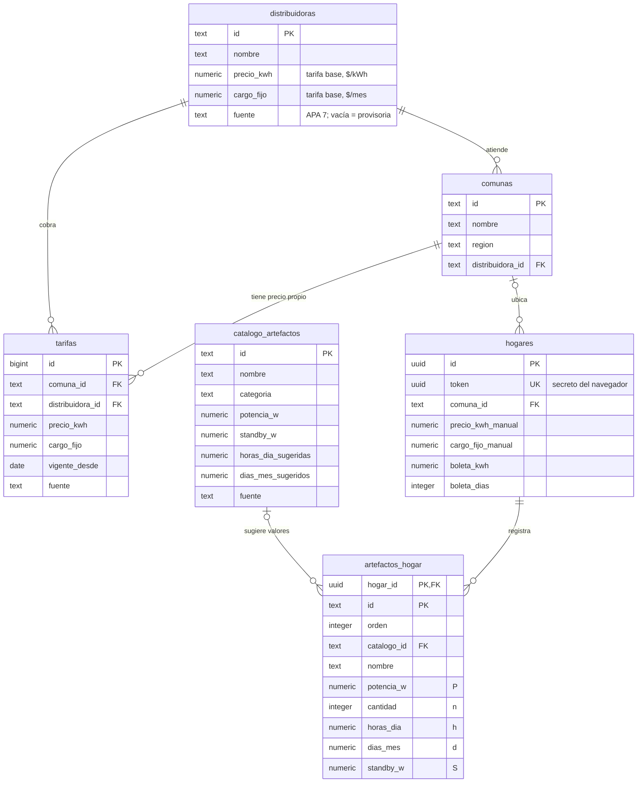

# Base de datos de EcoConsumo (Supabase)

- `migrations/20261122190000_esquema_inicial.sql`: tablas, vista, funciones y seguridad.
- `seed.sql`: datos de **ejemplo** (los mismos de `src/lib/datos/ejemplo.ts`). Se puede ejecutar varias
  veces.

## Modelo de datos

**Selección automática de la tarifa** (retroalimentación de la docente): la comuna determina la
distribuidora; la vista `comunas_con_tarifa` entrega, para cada comuna, la tarifa propia más reciente con
`vigente_desde ≤ hoy`. Si la comuna no tiene tarifa propia, la aplicación usa la tarifa base de la
distribuidora. Una tarifa solo puede registrarse para la distribuidora que atiende la comuna.

**Datos provisorios:** mientras alguna distribuidora, tarifa de comuna o artefacto del catálogo no tenga
`fuente`, la aplicación muestra el aviso «Datos de ejemplo». Al cargar los datos de Bairon y Andre, completar
la fuente de cada fila.

**Mismas reglas que la aplicación:** las restricciones `check` de `artefactos_hogar` son las de
`validarArtefacto()` (`src/lib/matematica/funciones.ts`): potencia > 0, cantidad entera ≥ 1, horas entre 0 y
24, días entre 0 y 30, standby ≥ 0.

## Seguridad (sin inicio de sesión)

- Cada navegador genera un **token** aleatorio (UUID) y lo guarda en `localStorage`. Quien conoce el token
  puede leer y modificar ese hogar; no hay forma de listar los hogares de otras personas.
- Las tablas `hogares` y `artefactos_hogar` tienen RLS activado y **ningún** permiso para el público. Solo se
  accede con las funciones `obtener_hogar(token)`, `guardar_hogar(token, datos)` y `eliminar_hogar(token)`
  (`security definer`), que filtran por el token.
- Los datos de referencia tienen RLS con lectura pública; solo se modifican desde el panel de Supabase.

## Puesta en marcha

1. Crear un proyecto en [supabase.com](https://supabase.com) (región São Paulo, la más cercana a Chile).
2. En **SQL Editor**, ejecutar el contenido de `migrations/20261122190000_esquema_inicial.sql` y luego el de
   `seed.sql`.
3. En **Project Settings → API**, copiar la URL del proyecto y la clave **anon / publishable**.
4. Copiar `.env.example` como `.env` en la raíz del proyecto y completar `PUBLIC_SUPABASE_URL` y
   `PUBLIC_SUPABASE_ANON_KEY`. En Vercel, agregar las mismas variables al proyecto.
5. `pnpm run dev`: la aplicación lee comunas, tarifas y catálogo desde Supabase y guarda el hogar ahí.

Si las variables no están definidas, la aplicación funciona igual con los datos de ejemplo y guarda el hogar
solo en el navegador.

Alternativa con la CLI de Supabase: `npx supabase init`, `npx supabase link --project-ref <ref>` y
`npx supabase db push`.
